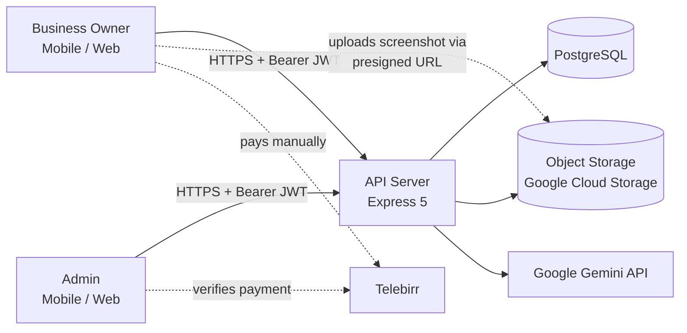
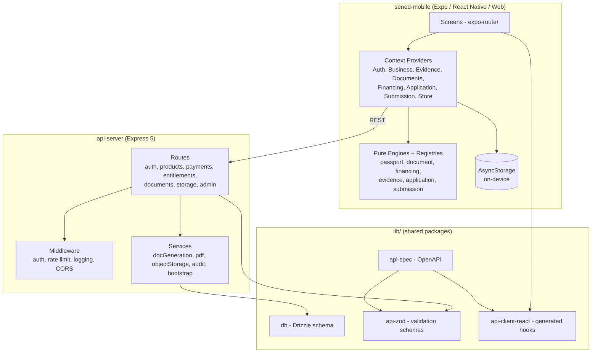
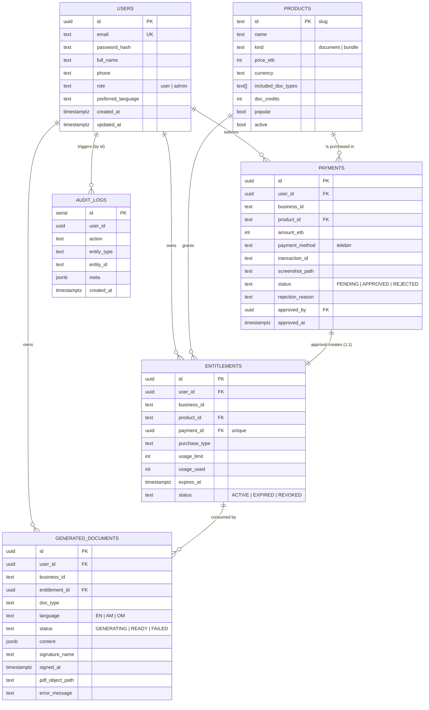
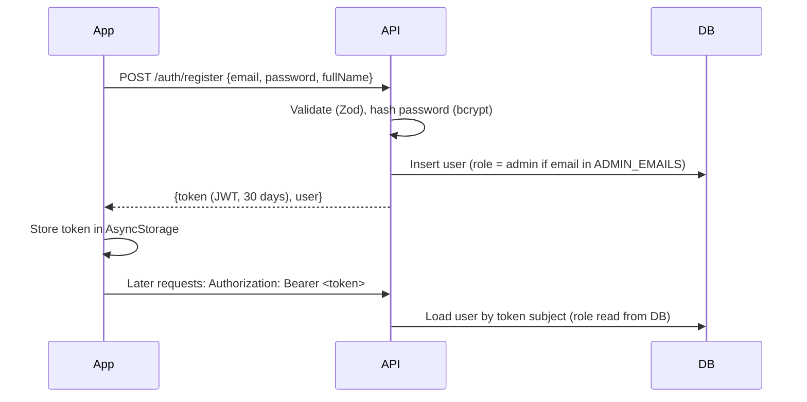
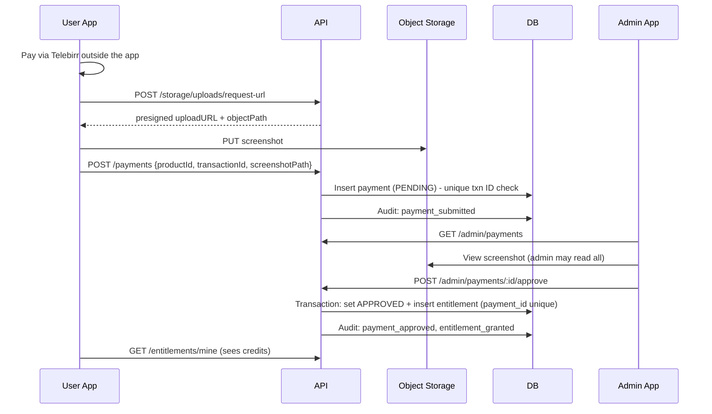
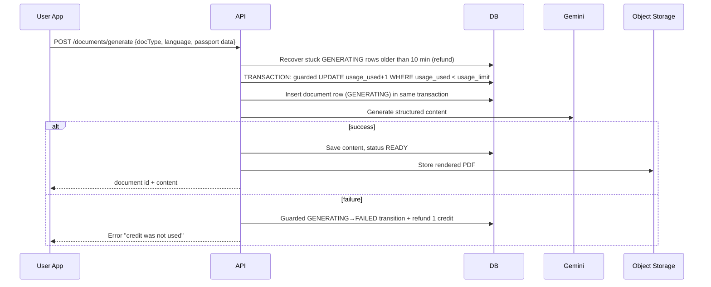
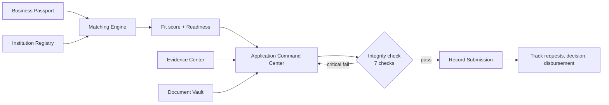

# SENED AI — System Design Document

**Project:** SENED AI — AI-powered business document and financing preparation platform for Ethiopian businesses
**Author:** Abdulkarim Abafira
**Version:** 1.0
**Date:** November 21, 2026
**Status:** MVP implemented; production hardening in progress

---

## Table of Contents

1. [Introduction](#1-introduction)
2. [Requirements](#2-requirements)
3. [High-Level Architecture](#3-high-level-architecture)
4. [Technology Stack](#4-technology-stack)
5. [Repository Structure](#5-repository-structure)
6. [Mobile Application Design](#6-mobile-application-design)
7. [Backend API Design](#7-backend-api-design)
8. [Data Design](#8-data-design)
9. [Key Workflows](#9-key-workflows)
10. [Security Design](#10-security-design)
11. [Reliability and Consistency](#11-reliability-and-consistency)
12. [Internationalization](#12-internationalization)
13. [Deployment and Environments](#13-deployment-and-environments)
14. [Limitations and Future Work](#14-limitations-and-future-work)
15. [Glossary](#15-glossary)

---

## 1. Introduction

### 1.1 Purpose

This document describes the architecture and design of **SENED AI**. SENED helps small and medium business owners in Ethiopia to:

- keep all their business information in one structured profile (the **Business Passport**),
- prepare professional documents (loan letters, business plans, cash-flow projections, and similar),
- understand the financing requirements of Ethiopian banks and microfinance institutions,
- verify and organize supporting evidence (licenses, TIN, bank statements),
- prepare, record, and track financing applications from preparation to disbursement,
- buy premium AI-generated documents using **Telebirr**, with manual admin approval.

### 1.2 Problem Statement

Many Ethiopian business owners are rejected for loans or never apply. The causes are usually incomplete paperwork, unclear lender requirements, and a lack of professional documents. Most of this work is done by hand, in English or Amharic only, and without guidance. SENED turns it into a guided, mobile-first, trilingual workflow.

### 1.3 Goals

| # | Goal |
|---|------|
| G1 | One source of truth for business data (the Business Passport). |
| G2 | Trilingual support: English, Amharic (አማርኛ), Afaan Oromoo. |
| G3 | Work with unreliable connectivity: core preparation features run on-device. |
| G4 | Monetize premium AI documents with payment methods used in Ethiopia (Telebirr). |
| G5 | Never promise loan approval. Language is always "potential match" or "preparation readiness". |
| G6 | Safe handling of credits and payments (no double spend, no lost credit). |

### 1.4 Non-Goals (current version)

- Submitting applications to banks automatically. SENED **records** that a user submitted through the bank's own channel.
- Real OCR or bank API integration (simulated extraction is used behind a swappable interface).
- Automated Telebirr payment verification (admins approve manually).
- Accounting or bookkeeping features.

### 1.5 Scope

The system has two runtime parts: a **mobile/web client** (Expo React Native) and a **REST API server** (Express and PostgreSQL). Both live in one pnpm monorepo.

---

## 2. Requirements

### 2.1 Functional Requirements

| ID | Requirement |
|----|-------------|
| FR-01 | Users can register, log in, and view their profile. |
| FR-02 | Users can create one or more businesses and complete a 12-section Business Passport. |
| FR-03 | The system calculates passport completeness, workflow readiness, and the next best action. |
| FR-04 | Users can browse 28 document templates, fill gaps, preview, save, and export PDF. |
| FR-05 | Users can upload evidence (camera, gallery, file), classify it, confirm extracted fields, and resolve conflicts with the passport. |
| FR-06 | The system matches the business to financing products from 6 institutions and scores fit and readiness. |
| FR-07 | Users can create a financing application with a document package, tasks, notes, consistency checks, and a readiness score. |
| FR-08 | Users can record submission to an institution, track requests, decisions, and disbursement. |
| FR-09 | Users can buy a product (single document or bundle) by paying through Telebirr and uploading a payment screenshot. |
| FR-10 | Admins can review, approve, or reject payments. Approval grants entitlements (credits). |
| FR-11 | Entitled users can generate premium AI documents, sign them, and download them as PDF. |
| FR-12 | The UI can switch between English, Amharic, and Afaan Oromoo. |

### 2.2 Non-Functional Requirements

| Category | Requirement |
|----------|-------------|
| **Availability** | Core preparation features work offline (data stored on-device). |
| **Security** | Passwords hashed, tokens signed, role checked in the database, private files protected by ownership checks. |
| **Consistency** | Credits can never be consumed twice or lost. Payment approval is idempotent. |
| **Performance** | API responses under about 500 ms except AI generation (seconds). |
| **Abuse protection** | Rate limits on login, payment submission, and document generation. |
| **Maintainability** | Data-driven registries so new templates, institutions, or products need no new screens. |
| **Localization** | All user-facing text has EN, AM, and OM variants. |
| **Auditability** | Security-sensitive events are written to an audit log. |

---

## 3. High-Level Architecture

### 3.1 System Context



### 3.2 Container View



### 3.3 Architectural Style and Key Decisions

| Decision | Rationale |
|----------|-----------|
| **Offline-first client for preparation data** | Business Passport, evidence, applications, and submissions are stored in AsyncStorage per user. Owners can prepare without a connection, and server cost stays low. |
| **Server only for trust-sensitive features** | Authentication, payments, entitlements, AI generation, and PDFs need a server. They involve money, secrets, and cost. |
| **Registry + engine pattern** | Templates, institutions, and evidence types are plain data. Pure functions compute results. One generic screen renders any template. |
| **Record-not-submit** | SENED records what the user submitted and never pretends to be the bank. This avoids legal risk and false promises. |
| **Manual Telebirr verification** | No public Telebirr merchant API is used yet. A human admin approves payments, so entitlements are only created by the server. |
| **Contract-first API** | The OpenAPI spec generates Zod schemas and React Query hooks, so client and server stay in sync. |
| **Swappable extraction provider** | `ExtractionProvider` is an interface. A deterministic simulator runs today. Real OCR can replace it without screen changes. |
| **Monorepo (pnpm workspaces)** | Shared types and schemas are used by the client and the server. |

---

## 4. Technology Stack

| Layer | Technology |
|-------|-----------|
| Mobile / Web client | Expo 54, React Native 0.81, React 19, expo-router 6, TypeScript |
| Client state | React Context providers, TanStack React Query, AsyncStorage |
| UI utilities | expo-image, expo-linear-gradient, expo-haptics, react-native-reanimated, react-native-svg |
| Device features | expo-image-picker (camera and gallery), expo-document-picker, expo-print, expo-sharing, expo-location |
| API server | Node.js, Express 5, TypeScript |
| Validation | Zod (`zod/v4`), drizzle-zod |
| Database | PostgreSQL with Drizzle ORM |
| Auth | JSON Web Tokens (jsonwebtoken), bcryptjs |
| AI | Google Gemini (`@google/genai`), model `gemini-flash-latest` |
| PDF | pdfkit with Noto Sans and Noto Sans Ethiopic fonts |
| File storage | Google Cloud Storage (presigned upload URLs) |
| Logging | pino and pino-http |
| Rate limiting | express-rate-limit |
| API codegen | Orval (OpenAPI to Zod and React Query hooks) |
| Build | esbuild (API), Metro (mobile), pnpm workspaces |

---

## 5. Repository Structure

```
SENED-AI/
├── artifacts/
│   ├── sened-mobile/        # Expo app (client)
│   │   ├── app/             # Screens (expo-router file-based routes)
│   │   ├── components/      # Reusable UI kit (Button, Card, Input, Badge...)
│   │   ├── context/         # State providers
│   │   ├── lib/             # Engines, registries, i18n, API client
│   │   ├── types/           # Domain types
│   │   └── server/          # Static web server + landing page
│   ├── api-server/          # Express REST API
│   │   └── src/{routes,lib,middlewares,types}
│   └── mockup-sandbox/      # Design preview tool (not part of the product)
├── lib/
│   ├── db/                  # Drizzle schema + connection
│   ├── api-spec/            # openapi.yaml + Orval config
│   ├── api-zod/             # Generated Zod schemas
│   └── api-client-react/    # Generated React Query hooks
├── scripts/                 # Workspace scripts
├── pnpm-workspace.yaml
└── tsconfig.base.json
```

---

## 6. Mobile Application Design

### 6.1 Navigation Structure

The app uses file-based routing (expo-router). Feature flows are **modal stack groups** that open above a six-tab main shell.

| Group | Purpose | Main screens |
|-------|---------|--------------|
| `(auth)` | Entry | welcome, login, register |
| `(onboarding)` | First setup | business-basics, goal |
| `(tabs)` | Main shell | Home, Business, Documents, Evidence, Financing, Profile |
| `(passport)` | Business Passport editing | overview, identity, location, ownership, legal, operations, financial, banking, financing |
| `(document)` | Document creation | select (catalog), flow (language → gaps → preview/export) |
| `(evidence)` | Evidence verification | upload, review, detail, conflict |
| `(financing)` | Financing intelligence | goal, matches, institution, product, checklist, command-center, package, review, submission, tracking, tasks, notes |
| `(submission)` | Submission tracking | integrity-check, record, detail, update-status, add-note, add-request, record-decision, record-disbursement |
| `(store)` | Commerce | product catalog, checkout, payments, premium document generate and view, admin |

### 6.2 State Management

State is split into **domain providers**. Each provider owns one feature and persists to AsyncStorage under a user-scoped key. Provider nesting reflects dependencies (an inner provider may use an outer one).

```
SafeAreaProvider
 └ ErrorBoundary
    └ I18nProvider
       └ AuthProvider            // token + user
          └ BusinessProvider     // businesses + Business Passport
             └ EvidenceProvider
                └ DocumentProvider
                   └ FinancingProvider
                      └ ApplicationProvider
                         └ SubmissionProvider
                            └ StoreProvider
                               └ QueryClientProvider
                                  └ KeyboardProvider → <Stack/>
```

**On-device storage keys**

| Key | Content |
|-----|---------|
| `@sened:auth_token` | JWT |
| `@sened:user` | Cached user profile |
| `@sened:businesses:<userId>` | All businesses with their passports |
| `@sened:active_business:<userId>` | Currently selected business |
| `@sened:docs:<userId>` | Document vault |
| `@sened:evidence:<userId>` | Evidence items |
| `@sened:fin_requests:<userId>`, `@sened:fin_saved:<userId>` | Financing requests and saved items |
| `@sened:apps:<userId>` | Financing applications |
| `@sened:submissions:<userId>` | Submission records |

### 6.3 Domain Modules (Registry + Engine)

Each module has: **types** (`types/*.ts`), a **registry** (static data), an **engine** (pure functions), and a **context** (persistence and actions).

#### 6.3.1 Business Passport (single source of truth)

- 12 sections: Identity, Location, Contact, Ownership, Legal, Operations, Employees, Financial, Banking, Financing, Evidence, Versions.
- Monetary values use a `StructuredAmount` `{ value, currency, period, sourceType, confidence, verified, updatedAt }`, so every number records where it came from and how reliable it is.
- The engine (`lib/passport.ts`) computes: per-section completeness, workflow readiness, a business health snapshot, and the **next best action**.
- A legacy flat `profile` is regenerated from the passport on every save (`passportToProfile`) for backward compatibility. A migration function upgrades older stored data once.

#### 6.3.2 Document System

- **28 templates** in a registry: Tier 1 (15, fully trilingual), Tier 2 (10, English-primary), Tier 3 (stubs, "coming soon").
- Each template declares its fields, validation, and a `generate` function. Fields can auto-fill from the passport through a `passportPath`.
- The engine performs gap analysis, resolves data from the passport, builds structured content (`sections → blocks`), and renders print HTML. A single screen (`flow.tsx`) serves every template.
- PDF export uses `expo-print` and `expo-sharing`, loaded with dynamic imports so the web bundle does not break.

#### 6.3.3 Financing Intelligence

- Registry of **6 institutions** (CBE, DBE, Dashen, Awash, CoopOro, ACSI), their products, and requirements.
- Every requirement is tagged with its source. Data is `MANUAL_RESEARCH` with `MEDIUM` reliability. Nothing is shown as officially verified without a citation.
- Engine functions: `runMatchingEngine`, `calculateFitScore`, `checkRequirements`, `calculateReadiness`.
- Language rule: "potential match" and "preparation readiness". Never "approved" or "guaranteed".

#### 6.3.4 Evidence and Verification

- 20 evidence document types with field definitions and passport mappings.
- Flow: pick file → classify → extract (simulated) → user confirms each field → detect conflicts with the passport → generate **update proposals**.
- Duplicate detection uses a hash of file name and size.
- Only safe string sections (identity, legal, location, banking) can be auto-updated. Financial amounts are never auto-patched.
- Conflict resolution offers three options: keep passport, use evidence, or review later.

#### 6.3.5 Application Command Center

- A `FinancingApplication` ties a business, institution, product, purpose, and amount together.
- It builds a **document package**, runs a cross-document **consistency check**, scores readiness, and manages tasks, notes, and an event timeline.
- It can export the final package as HTML/PDF.

#### 6.3.6 Submission and Disbursement Tracking

- Closes the loop: package → integrity check → record submission → institution follow-ups → decision → disbursement.
- The integrity check runs 7 checks and blocks submission on critical failures.
- Provides stale-submission warnings, a health score, and a next-best-action.

### 6.4 UI Component Library

A small internal kit (`Button`, `Card`, `Input`, `Badge`, `ProgressBar`, `EmptyState`, `Divider`, `ScreenHeader`) with theme colors from `constants/colors.ts` and `hooks/useColors.ts`. Badge variants: success, warning, danger, info, neutral, primary.

### 6.5 Error Handling

An `ErrorBoundary` and `ErrorFallback` wrap the app. API calls surface typed error messages to the screen. A font-loading timeout (100 ms) avoids a blank screen on Expo web.

---

## 7. Backend API Design

### 7.1 Layering

```
Route handler  →  validation (Zod)  →  auth/rate-limit middleware
      ↓
  Service helpers (auth, audit, docGeneration, pdf, objectStorage, bootstrap)
      ↓
  Drizzle ORM → PostgreSQL        Gemini API        Cloud Storage
```

All routes are mounted under `/api`. The server uses CORS, JSON and URL-encoded body parsing, and structured request logging.

### 7.2 Endpoints

| Method | Path | Auth | Description |
|--------|------|------|-------------|
| GET | `/api/healthz` | none | Health check |
| POST | `/api/auth/register` | none (rate-limited) | Create account |
| POST | `/api/auth/login` | none (rate-limited) | Log in, returns JWT |
| GET | `/api/auth/me` | user | Current user |
| GET | `/api/products` | none | Active product catalog |
| POST | `/api/payments` | user (rate-limited) | Submit a Telebirr payment with transaction ID and screenshot path |
| GET | `/api/payments/mine` | user | List my payments |
| GET | `/api/entitlements/mine` | user | List my credits |
| POST | `/api/documents/generate` | user + entitlement (rate-limited) | Generate a premium document |
| GET | `/api/documents/mine` | user | List my generated documents |
| GET | `/api/documents/:id` | owner | Document content |
| POST | `/api/documents/:id/sign` | owner | Add typed signature |
| GET | `/api/documents/:id/pdf` | owner | Download PDF |
| POST | `/api/storage/uploads/request-url` | user | Get a presigned upload URL (max 15 MB) |
| GET | `/api/storage/objects/*path` | owner or admin | Fetch a private file |
| GET | `/api/admin/payments` | admin | List payments for review |
| POST | `/api/admin/payments/:id/approve` | admin | Approve and grant entitlement |
| POST | `/api/admin/payments/:id/reject` | admin | Reject with reason |
| GET | `/api/admin/summary` | admin | Operations summary |

### 7.3 Rate Limits

| Endpoint group | Limit |
|----------------|-------|
| Register / login | 30 requests per 15 minutes |
| Payment submission | 10 per minute |
| Document generation | 6 per minute |

### 7.4 Startup Bootstrap

On every boot the server runs an **idempotent** bootstrap:

1. Upserts the product catalog (Business Plan 699 ETB, Loan Request Letter 149 ETB, Loan Ready Package 1,499 ETB with 4 credits).
2. Promotes the emails listed in `ADMIN_EMAILS` to the `admin` role (also done at registration).

A new deployment is therefore usable without manual SQL.

### 7.5 AI Document Generation

`docGeneration.ts` holds a spec for each document type (title and outline). It builds a prompt from the Business Passport data sent by the client plus a **language block** (EN, AM, or OM), calls Gemini, and expects structured `{ title, sections: [{ heading, body }] }`. `pdf.ts` renders the result with pdfkit using Noto Sans (Latin) and Noto Sans Ethiopic (Amharic).

---

## 8. Data Design

### 8.1 Entity-Relationship Diagram



### 8.2 Important Constraints

| Constraint | Purpose |
|------------|---------|
| `users.email` unique | One account per email. |
| `entitlements.payment_id` unique | **Idempotent approval**: approving the same payment twice cannot create two entitlements. |
| Partial unique index on `payments.transaction_id` where `status <> 'REJECTED'` | Blocks reuse of a Telebirr reference, but a rejected payment can be corrected and resubmitted. |
| Foreign keys on user, product, payment, entitlement | Referential integrity. |
| Guarded update `usage_used < usage_limit` | Credits cannot go over the limit under concurrency. |

> **Note:** the partial unique index was applied with manual SQL because `drizzle-kit push` did not detect the change. Re-apply it if the database is recreated.

### 8.3 Data Split: Server vs Device

| Data | Where | Why |
|------|-------|-----|
| Accounts, payments, entitlements, premium documents, audit logs | **PostgreSQL** | Trust and money. |
| Payment screenshots, generated PDFs | **Object storage** (private) | Binary files. |
| Business Passport, evidence, applications, submissions, document vault | **On-device (AsyncStorage)** | Offline use, privacy, low server cost. |

The `payments.business_id` column is a client-side identifier because passports live on the device.

---

## 9. Key Workflows

### 9.1 Registration and Login



### 9.2 Purchase → Approval → Entitlement



### 9.3 Premium Document Generation (credit-safe)



The refund runs only on the guarded `GENERATING → FAILED` transition, so a credit **cannot be refunded twice**.

### 9.4 Financing Preparation (on-device)



---

## 10. Security Design

| Area | Design |
|------|--------|
| **Passwords** | Hashed with bcrypt (cost 10). Plain passwords are never stored or logged. |
| **Authentication** | Signed JWT (30-day lifetime) sent as a Bearer token. `SESSION_SECRET` is required at startup, and the server refuses to boot without it. |
| **Authorization** | `requireAuth` loads the user from the database on every request. The **role is never trusted from the token alone**. Admin routes check the role server-side. |
| **Entitlements** | Created only on the server when an admin approves a payment. The client cannot grant itself credits. |
| **Private files** | Objects are served only to their owner (through payment or document ownership) or to an admin. Uploads use short-lived presigned URLs with a 15 MB cap. |
| **Input validation** | Zod validates request bodies. |
| **Abuse control** | Rate limits on auth, payments, and generation. |
| **Audit** | `audit_logs` records payment, entitlement, generation, and download events. Document contents and secrets are never logged. |
| **Secrets** | `GEMINI_API_KEY`, `SESSION_SECRET`, and `DATABASE_URL` come from environment variables, never from source control. |
| **Proxy awareness** | `trust proxy` is enabled so rate limiting sees real client IPs behind a reverse proxy. |
| **Disclaimers** | Generated documents carry a trilingual disclaimer that they are drafts and not official documents. |

**Known gaps to address before wide production use:** restrict CORS to known origins, add token revocation or refresh, add password reset, and use secure token storage on native (for example, SecureStore instead of AsyncStorage).

---

## 11. Reliability and Consistency

| Concern | Mechanism |
|---------|-----------|
| Double payment submission | Partial unique index on `transaction_id`. |
| Double approval | Unique `payment_id` on entitlements; approval inside a transaction. |
| Credit over-consumption | Atomic guarded `UPDATE ... WHERE usage_used < usage_limit`. |
| Lost credit on failure | Reservation row (`GENERATING`) inserted in the same transaction as the credit decrement; refund through a guarded transition. |
| Crash during generation | Stuck `GENERATING` rows older than 10 minutes are auto-refunded when the user lists documents or generates again. |
| Fresh deployment | Idempotent bootstrap of catalog and admins. |
| Client data migration | `migrateBusiness()` upgrades older stored businesses once. |
| Client crash | Error boundary with fallback UI. |
| Platform differences | Dynamic imports for native-only modules (print, share) so web does not crash. |

---

## 12. Internationalization

- Languages: **EN, AM (Amharic), OM (Afaan Oromoo)**.
- Catalogs are organized per feature (auth, onboarding, passport, documents, evidence, financing, submission, store, profile, tabs). Each entry is a tuple `[English, Amharic, Oromo]`.
- A central terminology file keeps business terms consistent.
- Document content is generated in the chosen language. On the server, `docLanguage.ts` supplies a language instruction to the AI prompt, and Ethiopic fonts are embedded for PDF rendering.
- Template keywords include all three languages for search.

---

## 13. Deployment and Environments

### 13.1 Runtime Components

| Component | Runtime |
|-----------|---------|
| API server | Node.js process, bundled with esbuild (`pdfkit` and `fontkit` kept external) |
| Mobile app | Expo (Expo Go / dev build) and a static web export served by `server/serve.js` |
| Database | PostgreSQL |
| Files | Google Cloud Storage bucket (private objects) |

### 13.2 Configuration

| Variable | Used by | Purpose |
|----------|---------|---------|
| `DATABASE_URL` | API, db | PostgreSQL connection |
| `SESSION_SECRET` | API | JWT signing (required) |
| `GEMINI_API_KEY` | API | AI generation (required) |
| `ADMIN_EMAILS` | API | Comma-separated admin emails |
| `PRIVATE_OBJECT_DIR`, `PUBLIC_OBJECT_SEARCH_PATHS` | API | Object storage locations |
| `PORT`, `NODE_ENV`, `LOG_LEVEL` | API | Server settings |
| `EXPO_PUBLIC_DOMAIN` | Mobile | Base URL of the API |

### 13.3 Environments

| Environment | Notes |
|-------------|-------|
| **Development (original)** | Replit: built-in Postgres, object storage sidecar, public dev domain. |
| **Development (current)** | Local machine with VS Code, pnpm, local or hosted Postgres, Expo Go on a phone. |
| **Production (target)** | Hosted API (container or PaaS), managed Postgres, own cloud storage bucket, Expo EAS builds for Android. |

### 13.4 Migration Notes (Replit → Local)

- Replace the Replit object-storage credential sidecar in `objectStorage.ts` with standard Google Cloud (or S3-compatible) credentials.
- Replace the Replit-specific dev script of the mobile app with a plain `expo start`, and point `EXPO_PUBLIC_DOMAIN` at the API host reachable from the phone.
- Provide a local `DATABASE_URL` and run the Drizzle schema push, then re-apply the partial unique index SQL.
- Remove Replit-only packages and config (`@replit/*`, `.replit`, `.replit-artifact`).

### 13.5 Build and Quality

- `pnpm run typecheck` runs the TypeScript build across libraries and apps.
- `pnpm --filter @workspace/api-spec run codegen` regenerates Zod schemas and hooks.
- `pnpm --filter @workspace/db run push` applies schema changes in development.

---

## 14. Limitations and Future Work

### 14.1 Current Limitations

| Limitation | Impact |
|------------|--------|
| Passport and application data live only on one device | No multi-device sync and risk of loss if the app data is cleared. |
| Evidence extraction is simulated | Users confirm fields manually. |
| Payments are verified manually | Slower and does not scale. |
| Financing requirements are manual research | May be outdated. Users must confirm with the institution. |
| No automated test suite documented | Regressions are caught by typechecking only. |
| Object storage tied to Replit sidecar | Must change for self-hosting. |

### 14.2 Roadmap

| Priority | Item |
|----------|------|
| High | Cloud sync of the Business Passport and applications (encrypted, per user) |
| High | Real OCR provider behind `ExtractionProvider` |
| High | Automated tests (unit tests for engines, integration tests for payment and credit flows) and CI |
| Medium | Telebirr merchant API integration with webhook-based verification |
| Medium | Password reset, refresh tokens, secure token storage |
| Medium | Push notifications for application and payment status |
| Medium | Admin web dashboard |
| Low | Bank API integrations, subscriptions, WhatsApp/Telegram bots |
| Low | More Tier 2/3 document templates and more institutions |

---

## 15. Glossary

| Term | Meaning |
|------|---------|
| **Business Passport** | The structured, 12-section profile of a business; the single source of truth. |
| **Evidence** | Uploaded supporting documents (license, TIN, statements) used to verify passport data. |
| **Entitlement** | A credit balance granted after an approved payment, allowing premium document generation. |
| **Registry** | Static data definitions (templates, institutions, evidence types). |
| **Engine** | Pure functions that compute results from registry and user data. |
| **Telebirr** | Ethiopian mobile money service from Ethio Telecom. |
| **ETB** | Ethiopian Birr. |
| **Tier 1/2/3** | Document template maturity levels: full trilingual, English-primary, coming soon. |
| **ORM** | Object-Relational Mapper (Drizzle). |
| **JWT** | JSON Web Token used for stateless authentication. |
